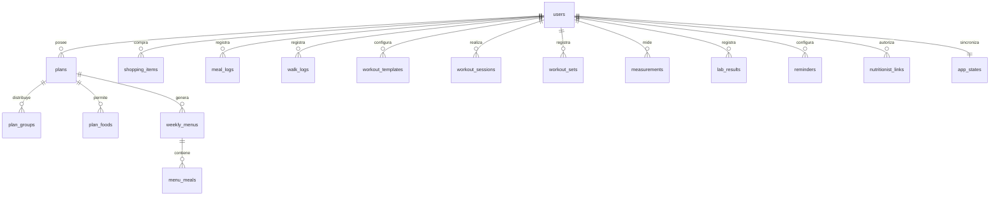

# Arquitectura y modelo

Next.js 15, React 19, TypeScript estricto y Tailwind 4. Exportación estática instalable; la información privada nunca se incrusta en la página publicada. Tipografía Manrope local. Tokens en `app/globals.css`.

## Esquema previo a la interfaz

`supabase/schema.sql` contiene las tablas y RLS. El MVP sincroniza un documento por usuario en `app_states`: las tablas normalizadas son el destino de una futura migración, **no están conectadas como repositorios individuales**. `users` referencia el identificador de Supabase Auth; sus registros no se crean automáticamente en esta versión. Los conjuntos mínimos de las tablas de registro usan `data jsonb`.

Estado: perfil, plan, menús por lunes ISO local, checks por fecha/tipo, compras por semana, agua y sueño por fecha, series, mediciones y exámenes. El menú guarda una copia del alimento y cantidad, para conservar registros previos. Regenerar una semana cambia su minuta sin borrar los checks; debe hacerse antes de usar la minuta para análisis clínico. Una revisión del plan se conserva en los menús ya creados, pero aún no hay historial completo del editor.

## Generador puro

Valida sumas y disponibilidad dietaria, luego selecciona un equivalente por grupo/comida. Para objetivos metabólicos usa preferentes en dos de cada tres turnos cuando existen dos o más opciones; evita repetir un alimento respecto del mismo horario del día anterior si hay alternativa. La distribución decide los carbohidratos de la cena: nunca se reducen por inferencia clínica. Con un solo equivalente puede haber repeticiones. La minuta es una combinación de alimentos, no un recetario culinario. Las cantidades semilla son ilustrativas y requieren validación nutricional.

Compras agrega `cantidadPorPorción × porciones` por identificador y unidad. No mezcla pesos cocidos/secos ni convierte tazas a gramos. Los artículos manuales se conservan; los checks llevan clave semanal.

## Sin conexión y sincronización

Service worker precarga HTML, scripts, CSS, fuentes e iconos. Requiere una primera visita conectada. LocalStorage conserva el estado y un marcador persistente de cambios pendientes: es una cola compactada del último estado, no un registro de cada evento. Se reintenta al abrir, editar o volver a estar conectado. Sin Supabase permanece solo local. La sincronización con app cerrada no está implementada.

Se consulta `updated_at` antes de escribir; actualizaciones usan comparación optimista. Si hay cambios concurrentes se bloquea la subida y se solicita respaldo, sin conciliación automática. Al cambiar de cuenta se limpia el estado del usuario anterior. No mezclar cuentas ni ediciones concurrentes para uso clínico hasta verificar estas rutas con Supabase real.

## Privacidad

Consentimiento previo al guardado local; Auth por enlace, RLS por cuenta, códigos aleatorios de 128 bits almacenados con hash SHA-256, vencimiento para canjear de 24 h, revocación por paciente. Un código canjeado mantiene el vínculo hasta revocación; el profesional obtiene solo nombre, cumplimiento, mediciones y exámenes mediante RPC, sin escritura. El paciente puede exportar JSON y solicitar borrado por RPC. No se usan analíticas ni venta de datos.

El navegador **no cifra** LocalStorage. El cifrado en reposo y las copias de seguridad deben verificarse en el proveedor configurado; el código no acredita ese requisito por sí solo. No existe Storage conectado porque no se adjuntan fotos ni PDF. Antes de operar con pacientes: revisar contratos, responsable del tratamiento, retención, respaldos, ejercicio de derechos, términos y cumplimiento de Ley 19.628 y reforma 21.719. No se certifica cumplimiento legal.

Fuente primaria: https://www.bcn.cl/leychile/navegar?idNorma=1209272 . Consultada el 7 de noviembre de 2026; revisar el texto vigente al lanzamiento y posibles modificaciones de su calendario.
